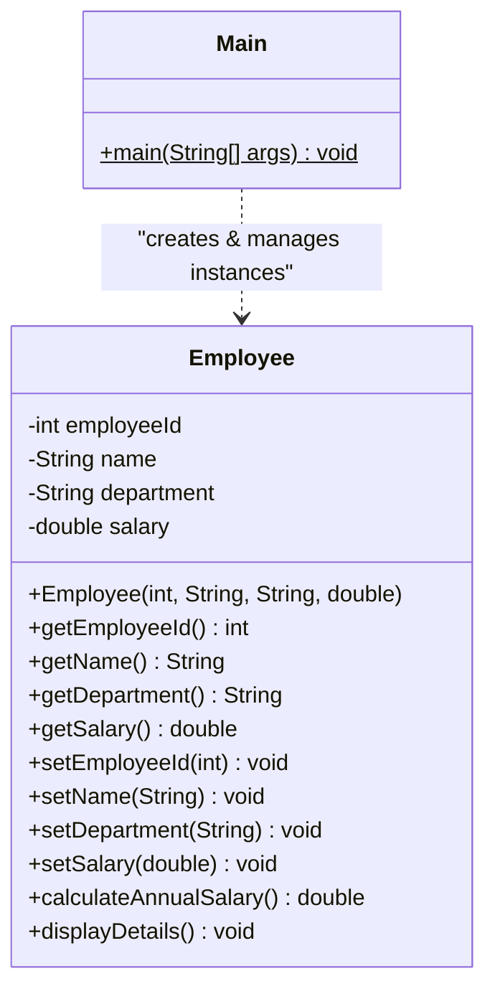
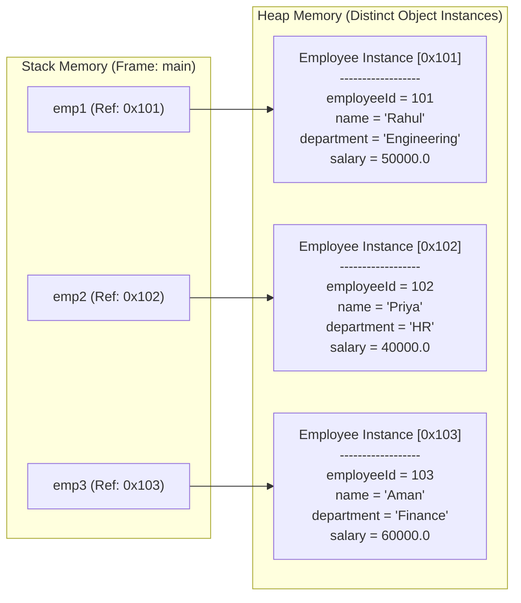

# Day 01: Low-Level Design in Java - Classes and Objects

## Overview
This module covers core Object-Oriented Programming (OOP) fundamentals in Java:
- Class as a blueprint vs. Object as an instance in memory.
- Encapsulation using `private` fields and `public` accessors/mutators.
- State independence among distinct object instances.
- Implementation of domain classes: `Employee`, `Student`, `Book`, and `BankAccount`.

---

## Architecture: Class vs. Object Relationship

A **Class** acts as a template or blueprint residing in Metaspace/Method Area. An **Object** is a concrete instance allocated in **Heap Memory**, referenced by a variable stored on the **Stack**.



### Memory Representation (Stack vs Heap)



---

## Deliverables Summary

1. **[Employee.java](file:///c:/Users/Parth/OneDrive/Desktop/low-level-design-java/week-01/Day-01/Employee.java)**:
   - Attributes: `employeeId`, `name`, `department`, `salary`.
   - Methods: `calculateAnnualSalary()`, `displayDetails()`, getters and setters.
2. **[Student.java](file:///c:/Users/Parth/OneDrive/Desktop/low-level-design-java/week-01/Day-01/Student.java)**:
   - Attributes: `rollNumber`, `name`, `marks`.
   - Method: `calculateGrade()` providing grade bands (A+, A, B, C, D, F).
3. **[Book.java](file:///c:/Users/Parth/OneDrive/Desktop/low-level-design-java/week-01/Day-01/Book.java)**:
   - Attributes: `title`, `author`, `isbn`, `isAvailable`.
   - Methods: `borrowBook()`, `returnBook()`, `displayDetails()`.
4. **[BankAccount.java](file:///c:/Users/Parth/OneDrive/Desktop/low-level-design-java/week-01/Day-01/BankAccount.java)**:
   - Attributes: `accountNumber`, `accountHolder`, `balance`.
   - Methods: `deposit(double)`, `withdraw(double)`, `displayDetails()`.
5. **[Main.java](file:///c:/Users/Parth/OneDrive/Desktop/low-level-design-java/week-01/Day-01/Main.java)**:
   - Working demonstration creating 3 independent Employee objects (Rahul, Priya, Aman).
   - Proof that updating Rahul's department and salary does not affect Priya or Aman.
   - Comprehensive test cases for Student, Book, and BankAccount.

---

## How to Run

Navigate to `week-01/Day-01` and execute:

```bash
javac *.java
java Main
```
