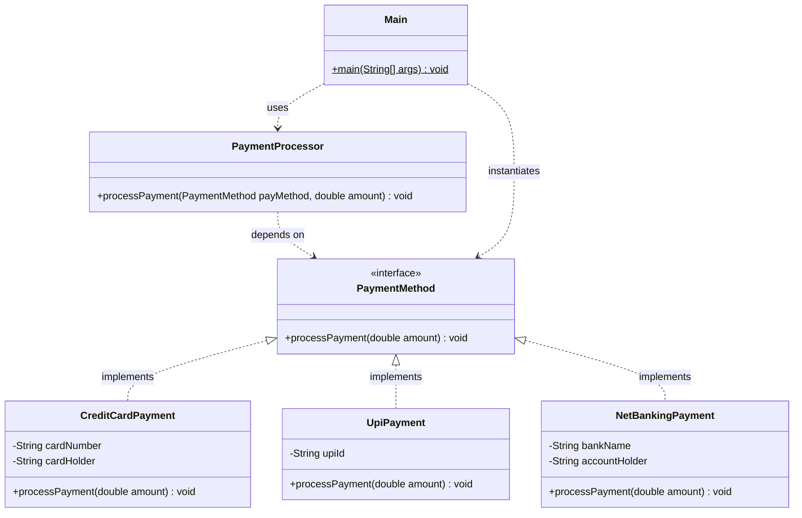

# Day 04: Polymorphism & Interface Design - Payment System

## Overview
This module demonstrates runtime polymorphism and interface-driven design using a real-world **Payment Gateway / Payment Processor** system.

---

## Design Principles Applied
1. **Interface Segregation & Abstraction**:
   - `PaymentMethod` defines the contract (`processPayment(double amount)`).
   - High-level modules depend on the abstraction (`PaymentMethod`), not concrete classes.
2. **Runtime Polymorphism**:
   - `PaymentProcessor` processes payments via `PaymentMethod`, completely agnostic of whether it is Credit Card, UPI, or NetBanking.
3. **Open/Closed Principle (OCP)**:
   - New payment channels (e.g. `CryptoPayment`, `WalletPayment`) can be added by implementing `PaymentMethod` without altering a single line of `PaymentProcessor`.

---

## Architecture Diagram



---

## How to Run

```powershell
cd 'week-01\Day-04\PaymentSystem'
javac *.java
java Main
```
